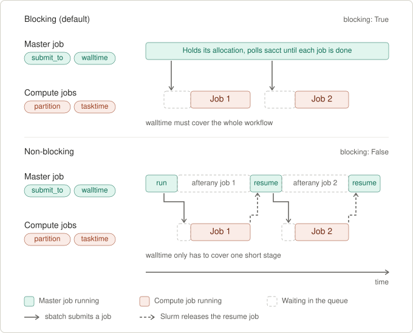

Setting up on a Cluster
=======================

Learn how to transition from running one of the `2D Workstation Examples 
<specfem2d_example>`__ to running on a Cluster. 

Note that to continue, SeisFlows will need to have a module supporting 
your HPC. You can check supported systems from the output of:

.. code:: bash

   seisflows print modules

If you do not find your System supported, have a look at 
`Extending SeisFlows <extending.html>`__ to support it. 

.. warning::

    This docs page assumes that you were able to succesfully install SeisFlows 
    and SPECFEM2D on your cluster. See the `installation guide <index.html>`__
    for instructions to install SeisFlows.

Blocking and non-blocking main jobs
-----------------------------------

SeisFlows runs as a 'main job' (or master job) that submits the compute jobs
of a workflow (the solver, preprocessing, smoothing, and so on) to the
scheduler. There are two ways for it to work, set by the ``blocking`` parameter
of the system module:

   The main job (teal) and the compute jobs (coral) in time. The labels on the
   left are the parameters that control each.

**Blocking** (``blocking: True``, the default). The main job is a single job
that lasts for the whole workflow. It submits each compute job and polls the
scheduler until the job is done, holding its allocation while it waits.

**Non-blocking** (``blocking: False``). The main job runs until it has
submitted a compute job, and also a second job that the scheduler holds back
until the first is done (``--dependency=afterany`` on Slurm, ``-W
depend=afterany`` on PBS). It then exits. When the compute job ends, whether it
succeeded or failed, the scheduler starts the held job, which resumes the
workflow from its state file. It collects the outcome of the job, re-runs any
tasks that failed (up to ``rerun`` times), and carries on to the next stage.
No job has to outlast one stage of the workflow.

Both kinds of main job run the same Python workflow, including the serial work
between compute jobs (reading misfits, updating the model, moving files), on a
compute node. Only the waiting is different.

Five parameters control the jobs, and they apply to different jobs. The three
partition parameters have the same form on every system, whatever the system
calls its partitions (a queue on PBS systems such as Miyabi, a resource group
on Wisteria):

.. list-table::
   :header-rows: 1
   :widths: 22 78

   * - Parameter
     - Controls
   * - ``partition_master``
     - The partition that the main job is submitted to, the first and every
       resumed one.
   * - ``walltime``
     - The time limit of each main job, in minutes. For a blocking main job
       this has to cover the whole workflow. For a non-blocking one it only has
       to cover one stage and the setup that is repeated when it resumes.
   * - ``partition_compute``
     - The partition that the compute jobs are submitted to, the ones that run
       once for every task (e.g., the simulations). It also sets how many cores
       per node they request. If not given it is ``partition_master``.
   * - ``partition_single``
     - The partition that the single-process jobs are submitted to, the ones
       that run once per stage (e.g., summing and smoothing the kernels). If
       not given it is ``partition_master``. Supported by the ``slurm``,
       ``chinook``, ``pbs`` and ``miyabi`` systems.
   * - ``tasktime``
     - The time limit of each compute and single-process job, in minutes.

.. note::

    These replace ``partition`` (``queue`` on Miyabi, ``rscgrp`` on Wisteria)
    and ``submit_to``. A parameter file that still uses them works, with a
    warning, but the compute partition was ``partition`` and now is
    ``partition_compute``, and the main job's was ``submit_to`` (which
    defaulted to ``partition``) and now is ``partition_master``.

A non-blocking main job does little computing, so it can be sent to a short or
debug queue with ``partition_master``, where the single-process jobs follow it
unless ``partition_single`` says otherwise, while the compute jobs use
``partition_compute``. These jobs usually start sooner than long ones, and do
not hold a large partition. A single-process job that has to wait in the queue
of the compute jobs can take hours to start for a few minutes of work.
Each resumed main job is a new job in the queue, which adds its queue time to
the time that the workflow takes. ``sflog.txt`` reports how long each job
queued and ran for. See `TestFlow <#testflow>`__ to check that a non-blocking
main job works on your system before running a research problem.

.. note::

    Non-blocking main jobs are supported by the ``slurm``, ``chinook`` and
    ``maui`` systems and the ``pbs`` and ``miyabi`` systems, and by the
    workflows that ship with SeisFlows. ``seisflows check`` says so if your
    choices do not support them.

Packing tasks into fewer jobs
-----------------------------

A scheduler treats every element of an array as a job of its own, and each one
waits in the queue. If the queue is long, or only a few jobs may run at once
(e.g., a limit on the number of running jobs for your project), a stage of 54
tasks can take far longer than the simulations do: with three jobs allowed at
once it runs in 18 waves, and each wave waits in the queue again.

With ``pack: True`` the tasks of an array are packed into ``njob`` jobs, each of
which runs its share of the tasks one after the other. A stage then waits in
the queue once (for the last of its jobs to start) rather than once for every
wave. Choose ``njob`` to be the number of jobs that the scheduler lets run at
once; ``1`` is the extreme, one job runs every task.

.. code:: bash

    seisflows par pack True
    seisflows par njob 3

How it works:

- The tasks are split into blocks of neighbouring ids that are as even as they
  can be, e.g., 54 tasks into 4 jobs are 14, 14, 13 and 13 tasks. They are
  expected to take about the same time.
- The time limit of a job is ``tasktime`` times the number of tasks in it, plus
  10%, so ``tasktime`` still means the time of **one** task and your partition
  has to allow the product (e.g., 18 tasks of 10 minutes is a job of 198
  minutes). ``ntask_max`` does not apply.
- Each task is run on its own, by its own process, so it has its own log
  (``logs/<job>_task<id>.log``) and its own ``tasktime``. A task that fails or
  runs out of time does not stop the tasks after it in the job.
- When a task ends it leaves a marker file in ``scratch/system/tasks``. A task
  without one (e.g., the job ended before it got to it) is a task that
  failed, and it is the failed tasks that are run again, up to ``rerun``
  times. A rerun of few tasks, no more than ``njob``, is a job for each.
- Single-process jobs (e.g., summing the kernels) are not packed.

``pack`` is supported by the ``slurm``, ``chinook``, ``pbs`` and ``miyabi``
systems. On Miyabi the number of jobs that run at once is a limit of the
project (see ``qstat --limit``), which is the ``njob`` to choose, or one less
if other jobs of the project run at the same time. With ``njob: 1`` the job is
not an array, as some PBS implementations do not accept an array of one.

TestFlow
---------

TestFlow is a SeisFlows 'Workflow' that ensures SeisFlows can properly interact 
with a given workload manager. 

Within a TestFlow workflow, SeisFlows submits 1-core test jobs to the system, 
checking that it can: 1) submit array and single jobs, 2) monitor the job queue, 
3) catch job failures. 

This is preferable to trial-and-error testing with simulation jobs, which
may be restricted by job priortiy, queue time, or allocation. To run TestFlow 
on your System:

.. code:: bash

    cd <path to working directory>  # empty directory on System

    # Generate a template parameter file
    seisflows init -f

    # Set appropriate modules
    seisflows par workflow test_flow
    seisflows par system <name of your system> 
    seisflows par solver null 
    seisflows par preprocess null  
    seisflows par optimize null 

    # Dynamically fill out the parameter file
    seisflows configure

TestFlow does not require any input parameters, but Users are responsible for
filling out the System parameters correctly in the `parameters.yaml` file. 

You can check your parameter file validity with:

.. code:: bash

   seisflows check

To submit TestFlow to your system, run the following:

.. code:: bash

    seisflows submit

Monitor the main job log file (`sflog.txt`) to determine whether TestFlow is
running as expected. Errors in the parameter file or encountered during TestFlow
need to be addressed by the User. Individual job log files can be found in 
`logs/*`. 

Testing a non-blocking main job
~~~~~~~~~~~~~~~~~~~~~~~~~~~~~~~

TestFlow can also check a `non-blocking main job
<#blocking-and-non-blocking-main-jobs>`__ (``blocking: False``) without any
SPECFEM binaries, for systems that support it (e.g., ``chinook``, ``miyabi``).
Set the parameter before submitting:

.. code:: bash

    seisflows par blocking False
    seisflows par partition_master debug   # a queue for the short main job
    seisflows par partition_compute t1small
    seisflows submit

Each test then dispatches its job, and the main job finishes. The scheduler
starts it again once the job is done, and it picks up where it left off, which
is what is being tested. Because each trip through the queue takes time, the
workflow takes longer to finish than it does when blocking. ``sflog.txt`` shows
a line for each resumption, and how long each job queued and ran for. TestFlow
checks that:

- the main job is resumed after each job, including a job that failed,
- the tasks of an array that failed are the ones that are run again,
- the queue and run times of jobs can be read from the scheduler (otherwise a
  warning says that they cannot, which only affects the log),
- a check that fails on a compute node is not run again, which also checks that
  the main job and the compute nodes share a file system.

TestFlow starts over each time that it passes, so it can be submitted again
after changing a parameter.

Testing packed jobs
~~~~~~~~~~~~~~~~~~~

TestFlow can also check `packing tasks into fewer jobs
<#packing-tasks-into-fewer-jobs>`__ (``pack: True``), which is a good way to
find out whether your ``njob`` and the time limit that comes with it are
allowed, before running a research problem:

.. code:: bash

    seisflows par pack True
    seisflows par njob 3
    seisflows submit

TestFlow then runs its array of tests with three tasks for each of the ``njob``
jobs, and checks that there are that many jobs (and a log for each task), that
a task that fails does not stop the ones after it in its job, and that the
tasks that failed are the ones that are run again.

Due to the difficult nature of anticipating all quirks of a given compute
system, Users running on un-tested systems may encounter errors while running
TestFlow. Please feel free to `open a GitHub Issue 
<https://github.com/adjtomo/seisflows/issues>`__ if you cannot succesfully run
TestFlow.

Example Setup
-------------

To get a 2D example running on our system, we will run an example setup on the 
cluster's login node to establish a valid parameter file and working directory. 

.. code:: bash

   cd <path to working directory>  # empty directory
   seisflows examples setup 2 -r <path to specfem2d repository>

Succesfuly completion of the example setup will provide you with a parameter 
file and a SPECFEM2D working directory.

Module ‘swap’
-------------

The current example is set up to run on a Workstation. We will need to 'swap'
out the System module for a cluster-specific system interface.

To see the command line structure and help message for the 'swap' command:

.. code:: bash

    seisflows swap -h

The 'swap' command replaces variables for a given module without affecting 
the remainder of the parameter file.

.. code:: bash

    seisflows swap system <name of your system>

Note that valid system names can be learned with `seisflows print modules`.
Users should have a valid set of System parameters from running `TestFlow` in
the previous section.

’Check’ing parameter validity
-----------------------------

The 'swap' command will have set a number of default options for system-related
parameters in your parameter file.

It is up to the User to set correct values for these parameters by reading the
related docstrings and selecting valid options.

.. note::

    Example: the `partition_master` and `partition_compute` parameters tell
    SeisFlows where to submit the main job and the simulation jobs. Users
    should know which partition they want to submit their jobs, based on the
    size of the simulations and available cores per node.

Once you have set your parameter file, you should run the 'check' command to see
if the internal check functions still pass.

.. code:: bash

   seisflows check

Submitting the main job to system
---------------------------------

Once `seisflows check` returns without Error, Users should be able to submit
their job to system. 

.. code:: bash

   seisflows submit

Users can monitor the job status by watching `sflog.txt`. Individual simulation
jobs will also write log files to `logs/*`. File ids will match the 
corresponding job number.

Pivoting to Research Problems
-----------------------------

Succesful completion of the SPECFEM2D example on your system means you will now
have a valid parameter file and working directory structure. 

Pivoting to larger scale research problems will involve Users providing their 
own models (2D or 3D) and parameters to SeisFlows.

Let's say you want to now run a large-scale synthetic inversion for two 
3D velocity models.A general list of steps to take:

1) manually generate your 3D starting and target models. model your 
   `specfem3d_workdir` structure off the example 2D working directory
2) swap out SPECFEM2D SeisFlows parameters for 3D

    .. code:: bash
        
        seisflows swap solver specfem3d
3) Fill out the required SPECFEM3D parameters that have now been swapped
4) Run SeisFlows with your existing parameter file

    .. code:: bash

        seisflows submit

